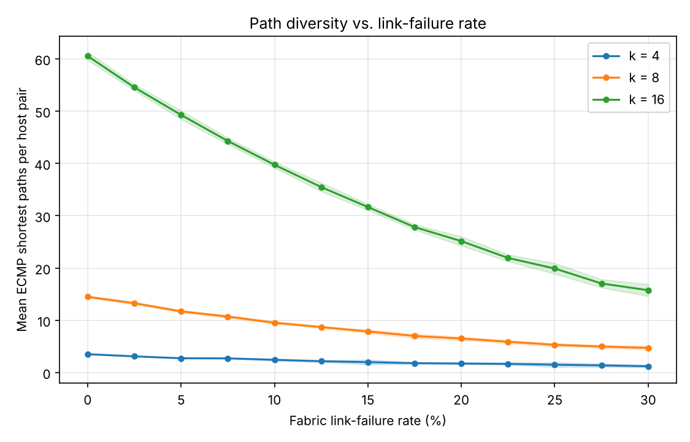
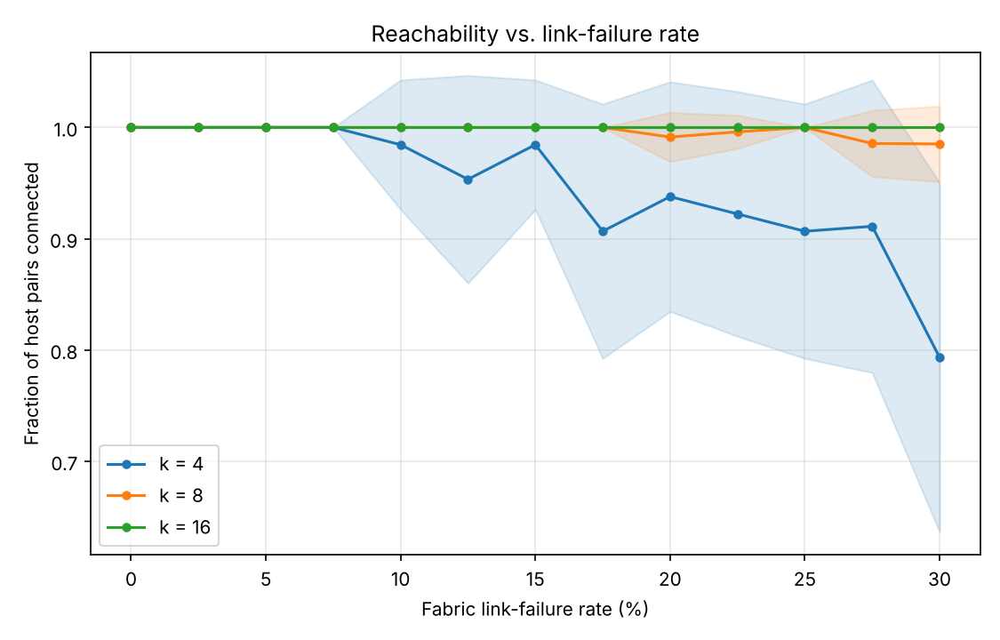
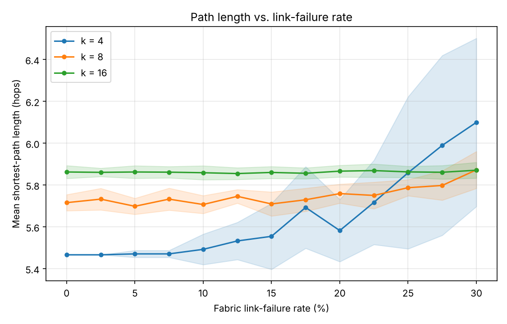
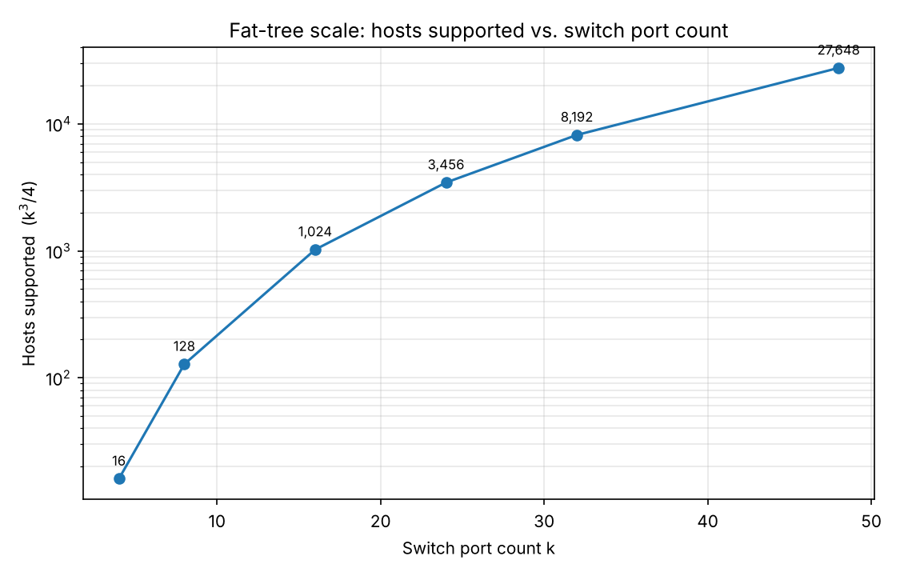

# Fat-Tree Network Topology Generation and Analysis

Homework 1 — *Communication Networks for Data Centers and AI* (361.2.2460), Fall 2026.

This project programmatically generates a **k-ary fat-tree** data center network,
introduces random link failures into its fabric, and quantitatively analyzes how
several structural and path-based metrics respond to those failures and to the
scale parameter `k`. The topology follows the design presented in Al-Fares,
Loukissas and Vahdat (SIGCOMM 2008) [1].

---

## 1. Background: the k-ary fat-tree

A fat-tree is a multi-rooted, three-tier (edge / aggregation / core) network built
entirely from identical commodity switches, each having `k` ports (`k` must be
even). Its appeal in data centers comes from **full bisection bandwidth** (every
host can in principle communicate with any other host at the full line rate of its
network interface) together with a large number of **equal-cost paths** between any
two hosts, which provides both load-balancing headroom and fault tolerance.

The topology is organized into `k` *pods*. Each pod contains `k/2` edge switches
and `k/2` aggregation switches, wired together as a complete bipartite graph (every
edge switch connects to every aggregation switch within the same pod). Each edge
switch, in turn, connects to `k/2` hosts below it. Above the pods sit `(k/2)²` core
switches, arranged conceptually as a `(k/2) × (k/2)` grid indexed `(i, j)`. The
wiring rule for the core is the one subtle part of the construction: the *i*-th
aggregation switch of **every** pod connects to the entire *i*-th row of the core
grid, i.e. to core switches `(i, 0) … (i, k/2 − 1)`. As a result, each core switch
`(i, j)` connects to the *i*-th aggregation switch in each of the `k` pods and
therefore uses all `k` of its ports.

This construction yields the following closed-form structural properties, which the
generator reproduces exactly:

| Quantity | Formula | k = 4 | k = 8 | k = 16 |
|---|---|---|---|---|
| Pods | k | 4 | 8 | 16 |
| Hosts | k³ / 4 | 16 | 128 | 1,024 |
| Core switches | (k/2)² | 4 | 16 | 64 |
| Aggregation switches | k² / 2 | 8 | 32 | 128 |
| Edge switches | k² / 2 | 8 | 32 | 128 |
| Total switches | 5k² / 4 | 20 | 80 | 320 |
| Equal-cost paths between two hosts in different pods | (k/2)² | 4 | 16 | 64 |

The last row is the structural reason fat-trees are resilient: between a pair of
hosts in different pods there are `(k/2)²` distinct shortest paths of equal length,
each one leaving the source pod through a different aggregation switch and traversing
a different core switch. Failures must erode this redundancy substantially before
connectivity is actually lost — which is precisely what the experiments below
measure.

---

## 2. Repository structure

```
fat-tree-topology/
├── fattree.py        Topology generator: the FatTree(k) class + a CLI, and a
│                     BFS routine that counts equal-cost shortest paths.
├── failures.py       Random link-failure injection (by percentage, reproducible).
├── metrics.py        Path and structural metrics (ECMP path count, connectivity,
│                     path length, hosts supported).
├── experiment.py     Experiment driver: Monte Carlo sweeps + plot generation.
├── requirements.txt  Python dependencies.
├── results/          Generated plots (PNG), referenced in Section 6.
└── README.md         This file.
```

---

## 3. Installation

The code targets Python 3.9+ and depends only on three standard scientific
packages.

```bash
pip install -r requirements.txt
```

---

## 4. Usage

### 4.1 Generating and inspecting a topology

`fattree.py` builds a topology for a chosen `k`, optionally applies link failures,
and prints a structural summary together with path statistics computed over a
sample of random host pairs:

```bash
# A k = 4 fat-tree, no failures:
python fattree.py --k 4

# A k = 8 fat-tree with 10% of fabric links failed, reproducible via a seed:
python fattree.py --k 8 --failure 0.10 --seed 1
```

### 4.2 Running the experiments

`experiment.py` runs all four experiments described in Section 6 and writes one
plot per experiment into the output directory:

```bash
python experiment.py                # full run -> results/*.png
python experiment.py --quick        # coarser/faster run, for a quick check
python experiment.py --out myplots   # choose a different output directory
```

---

## 5. Input specification and failure modeling

### 5.1 Inputs (assignment section 3)

The single structural input parameter is the **switch port count `k`**, a positive
even integer. Because every other quantity of the topology — the number of pods,
switches at each tier, hosts, and the per-tier wiring — is a deterministic function
of `k`, this one parameter fully specifies a topology, and the generator is
therefore flexible across the entire family of fat-trees simply by varying it
(`k = 4, 8, 16, 24, 48, …`). The command-line interface additionally exposes a
random **seed** so that any experiment involving randomness can be reproduced
exactly, and a **sample-pairs** count controlling how many random host pairs are
used for the reported path statistics.

### 5.2 Failure modeling (assignment section 4)

Link failures are supplied as an optional `--failure p` parameter, where `p ∈ [0, 1]`
is the fraction of eligible links to remove. The implementation removes
`round(p · N)` links chosen uniformly at random, where `N` is the number of eligible
links, and it operates on a copy of the topology so the pristine graph is preserved
for comparison.

A deliberate modeling choice is that **only fabric (switch-to-switch) links are
eligible to fail by default**; host access links are excluded. The reason is that a
host attaches to the fabric through a single edge-switch uplink, so failing that
link merely isolates one host and reveals nothing about the redundancy of the
switching fabric. It is the fabric's redundancy that the fat-tree is engineered to
provide, and therefore the fabric links are the meaningful target of a resilience
study. (Host links can still be included programmatically via the
`include_host_links` flag.)

---

## 6. Experiments and results (assignment sections 5–6)

Three of the four experiments are **Monte Carlo sweeps**: at each failure rate the
random failure process is repeated `--trials` times (15 in the full run) and the
metric is averaged over trials; each metric value is itself computed over a sample
of random host pairs (300 in the full run). In the plots, the solid line is the mean
across trials and the shaded band is ± one standard deviation, so the band width
conveys how variable the outcome is from one random failure pattern to another. All
sweeps are run for `k = 4, 8, 16` on the same axes so that the effect of network
scale is directly visible.

### 6.1 Path diversity vs. link-failure rate (headline — the "advanced" metric)

**Setup.** For each value of `k ∈ {4, 8, 16}` and each fabric link-failure rate from
0% to 30%, we measure the mean number of equal-cost (ECMP) shortest paths between
randomly sampled host pairs. A disconnected pair contributes zero paths, so this
single metric captures both the thinning of path diversity and outright loss of
reachability.



**Discussion.** At zero failures the measured means (≈ 3.5 for `k = 4`, ≈ 14.5 for
`k = 8`, ≈ 60.5 for `k = 16`) sit just below the theoretical inter-pod maximum of
`(k/2)²` (4, 16, 64). The small gap is expected: the sample of random host pairs
also includes a minority of same-pod pairs (`k/2` paths) and same-edge pairs (a
single path), which pull the average down slightly. As failures accumulate the mean
falls smoothly rather than collapsing, which is the signature of a richly redundant
fabric: even at a 30% fabric-failure rate a `k = 16` fat-tree still offers, on
average, more than 15 equal-cost paths per host pair. The absolute amount of
redundancy — and therefore the absolute amount that survives a given failure rate —
grows quadratically with `k`, which is why the three curves are so widely separated.

### 6.2 Reachability vs. link-failure rate

**Setup.** Identical sweep, but the metric is the fraction of sampled host pairs that
remain connected (have at least one path) at each failure rate.



**Discussion.** This view isolates the robustness implication of the path diversity
seen above. For `k = 16` every sampled pair stays connected across the entire sweep:
there is so much redundancy that random removal of up to 30% of fabric links never
severs a host pair in these trials. For `k = 8` connectivity stays above ~98% even at
30%. The small `k = 4` network, with only four core switches and four inter-pod
paths per pair, is visibly more fragile — its connected fraction drifts down toward
~0.8 at 30% and the wide shaded band shows that the outcome depends heavily on which
links happen to fail. The clear message is that fat-tree fault tolerance is not a
fixed property but one that **scales with `k`**: larger fabrics tolerate
proportionally harsher failure conditions.

### 6.3 Path length vs. link-failure rate

**Setup.** Identical sweep; the metric is the mean shortest-path length (in hops)
over the connected pairs.



**Discussion.** In a pristine fat-tree, two hosts in different pods are always six
hops apart (host → edge → aggregation → core → aggregation → edge → host), same-pod
pairs are four hops apart, and same-edge pairs two. The different baseline heights of
the three curves simply reflect pair composition: a larger `k` produces more pods, so
a larger share of random pairs is inter-pod and the average length is higher. The
more interesting behaviour is the *shape*. For `k = 8` and `k = 16` the mean length
is essentially flat: because many equal-cost shortest paths exist, failures remove
some of them but almost never remove *all* of them, so the shortest achievable length
is unchanged. For `k = 4` the mean length rises appreciably at high failure rates,
from ≈ 5.47 to ≈ 6.1 hops, because once the few shortest paths for a pair are gone the
traffic must take a strictly longer detour. Redundancy, in other words, protects not
only reachability but also *path length* — a network with ample ECMP paths keeps
traffic on minimal-length routes even under stress.

### 6.4 Scale: hosts supported vs. switch port count (the "basic" metric)

**Setup.** A purely structural experiment: the number of hosts a fat-tree supports,
`k³ / 4`, plotted against the switch port count `k` on a logarithmic vertical axis.



**Discussion.** This plot makes concrete why fat-trees are built from commodity
switches: capacity grows with the **cube** of the port count. A modest 24-port switch
already supports 3,456 hosts, and a 48-port switch supports 27,648 — all at full
bisection bandwidth and using only identical, inexpensive switches. This cubic scaling
is the economic argument of the original paper [1] and the reason the fat-tree remains
a reference design for large data center fabrics.

---

## 7. Tuning the experiments and expected effects

The topology generator `fattree.py` is fully parameterised through its command line
(`--k`, `--failure`, `--seed`), so a topology of any even `k` can be generated and
inspected without editing code. The experiment driver `experiment.py` instead reads a
small configuration block at the top of `main()`, which the user is meant to adjust to
trade accuracy and scope against running time:

```python
k_sweep       = [4, 8, 16]                                   # which network sizes to compare
failure_rates = [round(0.025 * i, 3) for i in range(0, 13)]  # x-axis: 0% .. 30%
trials        = 15                                           # Monte Carlo repetitions
sample_pairs  = 300                                          # host pairs sampled per metric
```

Each parameter affects the resulting plots in a predictable way:

- **`sample_pairs`** controls the sampling noise *within* a single trial. Each metric
  value is an average over this many randomly chosen host pairs, so raising it (e.g. to
  1000) makes every plotted point a more faithful estimate of the true population
  average and produces visibly **smoother, less jagged curves**. Cost grows linearly.
- **`trials`** controls the Monte Carlo averaging *across* random failure patterns. The
  solid line is the mean over trials and the shaded band is ± one standard deviation, so
  raising it (e.g. to 50) yields a **more stable mean and a more trustworthy band**; the
  uncertainty of the mean itself shrinks as `1/sqrt(trials)`. The band reflects the
  genuine variability between failure patterns and does not vanish — it is estimated
  more precisely. Cost grows linearly.
- **`failure_rates`** sets the resolution and range of the x-axis. A finer step (e.g.
  `0.01`) gives higher resolution; a wider range (e.g. up to `0.60`) reveals **where
  connectivity eventually collapses**, which for small `k` happens beyond the default
  30% window. Cost grows linearly in the number of points.
- **`k_sweep`** chooses which network sizes are overlaid. Adding `24` or `32` makes the
  scaling trends clearer, but the cost of each added value grows roughly as `k^3`
  (the graph has `Θ(k^3)` nodes and edges), so large `k` is expensive.

As a rule of thumb the total work is proportional to
`len(failure_rates) × trials × sample_pairs × k^3`. Because `k = 4` and `k = 8` are
cheap, `trials` and `sample_pairs` can be raised freely there to smooth the noisier
small-`k` curves, whereas `k = 16` and above should be scaled with care. All randomness
is driven by `--seed`, so any chosen configuration reproduces identically across runs.

---

## 8. Reproducibility

Every experiment is driven by an explicit random seed, so the figures in this README
can be regenerated exactly with `python experiment.py`. 

## 9. Reference

[1] M. Al-Fares, A. Loukissas, and A. Vahdat, "A scalable, commodity data center
network architecture," *SIGCOMM Comput. Commun. Rev.*, vol. 38, no. 4, pp. 63–74,
Oct. 2008. doi: 10.1145/1402946.1402967
